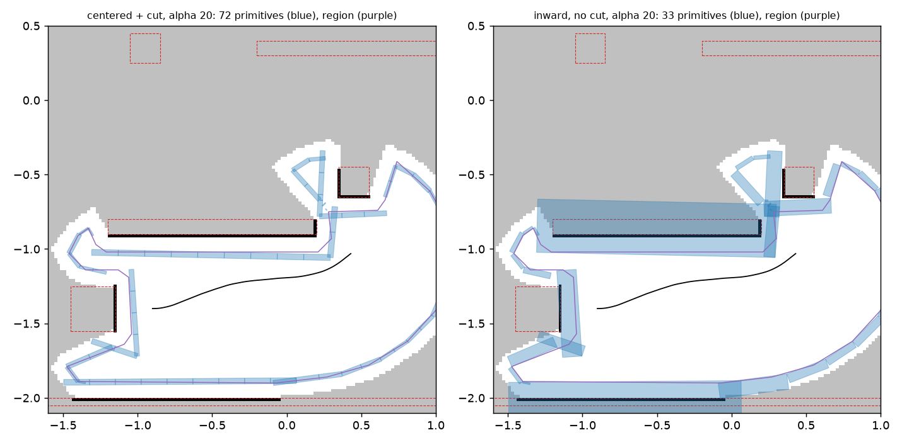
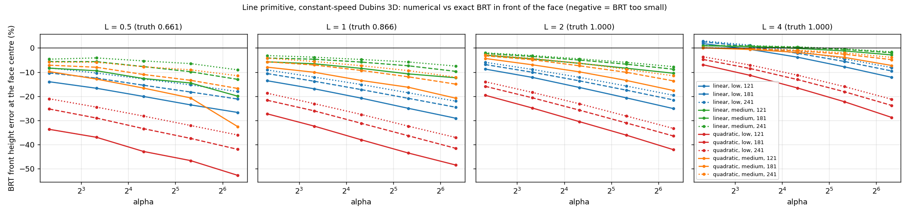
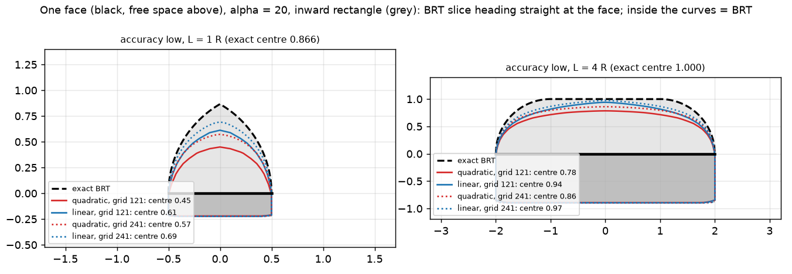
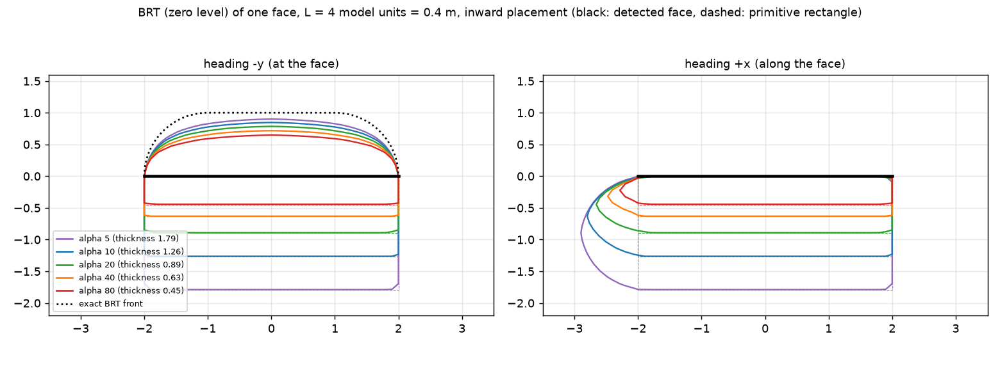

# 10 primitive 的放置、α 与离线求解精度

> 日期：2026-11-21，2026-11-22 更新（离线 `V₀` 接入，默认值切换）。动力学：恒速 Dubins 3D（v = ω_max = 1，转弯半径 R = 1 模型单位；Burger 上 R = 0.1 m）。
> 文中长度都以 **R** 为单位，这样结论可以直接换算到其他机器人。

## 10.1 结论

1. **primitive 应该"内移"放置**：矩形朝向自由空间的那条边和检测到的面重合，厚度全部落在障碍内部。这样 BRT 朝自由空间一侧的范围只由面长 L 决定，长面不用再切段。之前以面为中线对称放置、再靠切段压住伸出量，是一个部署偏差。
2. **离线 `V₀` 的精度比 α 重要得多**。原来在线用的配置（二次编码、一阶格式、121 网格）把面前方的 BRT 平均**低估约 0.22 R**，短面低估超过 40%。改用 **线性编码 + 241 网格**：`accuracy="medium"` 平均误差约 **0.04 R**，`low` 约 **0.09 R**。**现在用的是线性 + low**（2026-11-22 决定）：local update 的 kernel 是一阶格式，进 local update 的 primitive 必须用 `low`，全程只用一份 `V₀`。medium 和二次编码都保留成选项，离线解一次 4–8 s。
3. **α 推荐 20**。用推荐配置时，α=10 和 α=20 的误差只差约 0.007 R，起决定作用的是"薄墙背面穿出"，而 α=20 更薄。
4. **闭环（backup filter）对 α 不敏感**，三个场景里 5 个 α 的结果几乎相同。内移放置相比对称 + 切段：碰撞仍为 0，介入率下降，primitive 数减少 60–75%。对 `V₀` 的精度也不敏感：换成离线导出的线性 `V₀` 以后（low 和 medium 都试过），三个场景的结果和原来完全一样（[11](11_roadmap.md) §11.3）。
5. **BRS 不能用于避障**。fast-brt 现在的 `TargetSetMode "None"` 算的是 BRS，它在面前方的高度在所有配置下都是 **0**：正对着面冲过去的状态，会被判为安全。避障需要 BRT（`minVWithV0`）。local update 也要跟着改成 BRT，见 [12](12_local_update_brt.md)。
6. **最短面长**：厚度要有约 2 个 `V₀` 网格格子，即 `L_min ≈ 2·dx·√α`。241 网格、α=20 时约为 0.45 R（Burger 上 4.5 cm）。更短的面在转换时对称延长到 `L_min`，方向是保守的。

## 10.2 内移放置

对 configuration space 中的面 `(a, b, n)`（n 指向自由空间）：

$$
L = \|b - a\|, \qquad \beta = \operatorname{atan2}(b - a), \qquad
c = \frac{a+b}{2} - n\,\frac{L}{2\sqrt{\alpha}}, \qquad
V_f(x) = V_0\big(g^{-1}x\big) - \text{shift}(L),\ g = (c, \beta)
$$

`shift(L)` 在二次编码下是 `L²/4`，线性编码下是 `L/2`。代码：fast-brt 的 `fast_brt.query.PrimitiveV0.place`（内移、短面延长、长面厚度封顶），Robot-Sim 的 `nav_core.safety.place_faces`。**`BackupFilter` 的默认值已经是内移、不切段**；对称 + 切段保留成选项（`placement="centered", cut=True`）。



遮挡场景同一时刻的对比：左边是对称 + 切段（72 个 primitive），右边是内移、不切段（33 个）。右图里 screen_1（厚 0.1 m）下侧那个面的矩形从墙背面穿出约 0.2 m，这就是"薄墙穿出"；当时那一侧是未知区域，没有影响。

逐个检查过矩形的朝向：没有法向反掉的。前沿最多伸进可用区域 2.5 cm，来自面的"包裹"平移，属于保守方向，小于 3 cm 的 clearance。

## 10.3 精度复核（mars-14，odp）

脚本：`fast-brt/experiments/primitive_accuracy.py`（分支 `robot-sim`）。它复用 fast-brt 的 `Config`、`primitive_2d` 和 odp 的 `HJSolver`，扫描了 3 种网格 × 5 个 α × 2 种编码 × 2 种格式精度 × {BRT, BRS} × 4 种面长。

**真值**（BRT，horizon ≥ π/2）：车头正对面、离较近端点距离为 d 时，

$$
h^*(d) = \sqrt{1 - (1-d)^2}\quad (d < 1), \qquad h^*(d) = 1\quad (d \ge 1)
$$

也就是说，远离端点时 BRT 恰好在面前方 1 R 处。车从端点旁边绕过去，所以端点附近更矮；比转弯直径短的面（L < 2R），中心高度也小于 1。



同一个结果画成 BRT 本身更直观：一个面（黑色粗线，上方是自由空间），内移的 primitive 矩形（深灰），车头正对面时的 BRT 切片。黑色虚线和浅灰填充是精确 BRT；曲线以内是数值算出的 BRT。下图是 **low 精度**（本地 numpy 一阶格式，和 odp 的 `low` 同类），α=20：



所有曲线都在精确前沿以内（BRT 算小了）。短面（L = 1 R，10 cm）差得最多；同一网格下线性（蓝）总比二次（红）更接近精确值；加密网格（点线）两者都改善。含 `medium` 的完整版本用 `python experiments/primitive_accuracy.py --brt-figure` 在 mars-14 上生成（`plots/primitive_brt.png`）。

纵轴是面中心处的相对误差，负值表示 BRT 算小了。整条前沿的平均误差（单位 R，对 4 种面长取平均）：

| 编码 / 精度 / 网格 | α=5 | α=10 | α=20 | α=40 | α=80 |
| --- | --- | --- | --- | --- | --- |
| 二次 / low / 121（**现在在线用的**） | −0.155 | −0.186 | **−0.220** | −0.256 | −0.289 |
| 二次 / low / 241 | −0.097 | −0.121 | −0.146 | −0.175 | −0.204 |
| 二次 / medium / 241 | −0.031 | −0.037 | −0.045 | −0.057 | −0.073 |
| 线性 / low / 241 | −0.051 | −0.069 | −0.088 | −0.109 | −0.130 |
| **线性 / medium / 241（推荐）** | −0.026 | −0.029 | **−0.036** | −0.045 | −0.057 |

推荐配置下按面长分开看：

| α | L（Burger） | 厚度（格子） | 中心误差 | 整条前沿最大误差 |
| --- | --- | --- | --- | --- |
| 20 | 0.5 R（5 cm） | 2.2 | −5.4% | 0.040 R |
| 20 | 1 R（10 cm） | 4.5 | −4.8% | 0.042 R |
| 20 | 2 R（20 cm） | 8.9 | −4.5% | 0.055 R |
| 20 | 4 R（40 cm） | 17.9 | +0.4% | 0.056 R |

求解耗时（每个 `V₀`）：low 格式在 121 / 181 / 241 网格上分别约 0.7 / 1.8 / 3.6 s，medium 格式约 1.4 / 2.9 / 6.2 s。

### 为什么误差总是偏小，以及线性编码为什么更好

两种编码描述的是同一个矩形（`ℓ_q = ℓ_l² + L·ℓ_l`，严格单调），精确解的 BRT 完全相同，差别都来自数值格式：

1. **数值耗散会填平窄而浅的障碍凹槽（主因）。** 一阶格式相当于加了强度约为 Δx 的人工扩散。障碍在 value 里是一个负值凹槽，宽度是厚度 L/√α，深度在二次编码下约为 L²/4、线性编码下约为 L/2。扩散把凹槽抬高，零水平集往里收，BRT 就变小了。这一个机制同时解释了"α 越大越差"（凹槽越窄）、"面越短越差"（凹槽越窄越浅）、"二次比线性差"（凹槽更浅，而且处处有曲率 `∂²ℓ/∂y² = 2α`），也解释了误差为什么总是偏小。
2. **条件数。** 零水平集的位置误差 ≈ value 误差 / 梯度。二次编码在零水平集处的梯度为 `L·|∇ℓ_l|`，面短时很平坦；线性编码的梯度恒为 1 或 √α。

所以**提高格式精度**（降低耗散）和**改用线性编码**（改善条件数）都有用；实测显示前者的作用更大。

## 10.4 α：数值精度 vs 薄墙穿出

内移以后，α 只通过厚度 L/√α 起作用：

- **数值精度**：α 越小越好（见 10.3）；
- **薄墙穿出**：α 越大越好。厚度大于真实墙厚时，矩形会从墙的背面穿出来，让机器人在墙背面时更保守。这不会造成碰撞。

| L | α=5 | α=10 | α=20 | α=40 | α=80 |
| --- | --- | --- | --- | --- | --- |
| 0.4 m | 0.18 | 0.13 | 0.09 | 0.06 | 0.05 |
| 1.4 m | 0.63 | 0.44 | 0.31 | 0.22 | 0.16 |

（矩形厚度，单位 m）

单面 BRT 叠加图（L = 4 R，内移放置，所有 α 画在一起）：



这张图用的是**现在在线的配置**（二次、一阶、121），所以所有曲线都在精确前沿（黑色点线）下方，α 越大越低。右图（车头平行于面）里，端点那一侧的 BRT 范围取决于厚度，但那块区域在面的后方。

## 10.5 闭环：α 和放置方式

MPPI + backup filter（`unknown="occupied"`），对比对称 + 切段（α=20）和内移、不切段（α ∈ {5, 10, 20, 40, 80}）。原始数据：[figures/alpha_closedloop.csv](figures/alpha_closedloop.csv)。

| 场景 | 配置 | 到达 / 碰撞 / 超时 | 介入率 | primitive 数 | 最小距离 | ms/step |
| --- | --- | --- | --- | --- | --- | --- |
| hj（27 次） | 对称 + 切段 | 16 / 0 / 11 | 0.062 | 49 | 5.5 cm | 24 |
| | 内移，α=5–80 | 16 / 0 / 11 | **0.049** | **13** | 4.0 cm | 21 |
| 柱子（28 次） | 对称 + 切段 | 28 / 0 / 0 | 0.012 | 50 | 5.8 cm | 34 |
| | 内移，α=5–80 | 28 / 0 / 0 | **0.004** | **15.5** | 4.4 cm | 32 |
| 遮挡（23 次） | 对称 + 切段 | 16 / 0 / 7 | 0.072 | 94 | 5.0 cm | 39 |
| | 内移，α=5–80 | 16–17 / 0 / 6–7 | **0.062–0.068** | **37** | 3.2 cm | 36 |

- **所有配置都没有碰撞**；
- **内移比对称 + 切段好**：介入率下降，primitive 少 60–75%，略快；最小距离变小，说明没那么保守了；
- **α 几乎不影响结果**：backup filter 的安全靠几何，value 只用来提供一条候选控制。α 真正起作用的地方是 `hj` filter 和 local update，那两者接入后要重测；
- hj 场景的 11 次超时是 0.4 m 窄缝造成的结构性限制（见 [05 §5.6](05_safety_filter.md)），和 α 无关。

## 10.6 下一步（2026-11-22 状态）

1. ✅ fast-brt：`target_set_mode`（BRT / BRS）、任意长度（`V − shift(L)`）、点查询 `fast_brt.query`、导出命令 `export-v0`（[11](11_roadmap.md) 第 1、2 步）。
2. ✅ mars-14：四份 `V₀`（线性 / 二次 × low / medium，241 网格、α=20、BRT），只存最后一层，每份 14 MB（第 3 步）。
3. ✅ Robot-Sim：backup filter 迁到 `nav_core/safety`，加载 `V₀`（默认线性 / low），默认内移、不切段，重跑批量（第 4、5 步）。
4. 和师妹确认 library 用于避障时应该是 BRT（local update 的 BRT 版本已经做了，见 [12](12_local_update_brt.md)）。
5. α 对 `hj` filter 和 local update 的影响，等这两者接入后再测。

## 10.7 复现

```bash
# 精度复核（odp 环境，例如 mars-14）
cd fast-brt && python experiments/primitive_accuracy.py

# α 实验（legacy：需要迁移前的 Robot-Sim daac2c4 和 Hu-Hanyang/FaST-BRT 的 numpy 求解器，见脚本说明）
cd nav_core
PYTHONPATH=.:<FaST-BRT> python experiments/alpha_study.py {resolution,geometry,closedloop,figures}

# 迁移后的闭环批量（任意 V₀ 文件、放置方式）
PYTHONPATH=. python experiments/filter_batch.py --v0 ../fast-brt/results/v0/*.npz --placements inward centered+cut
```
